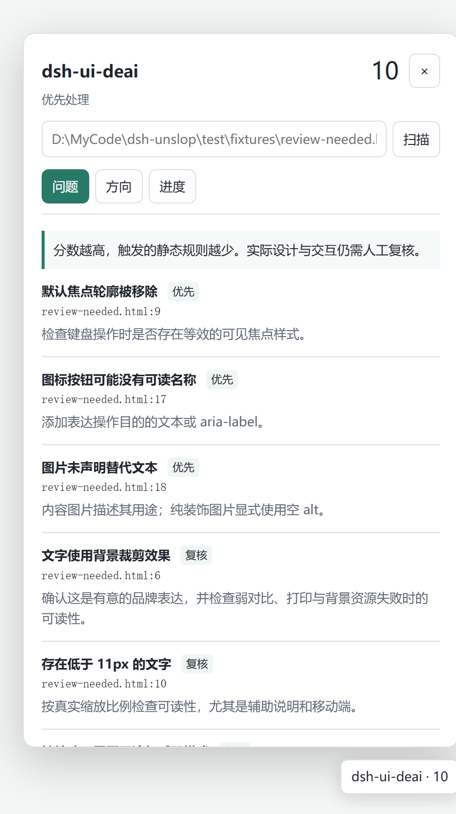

# dsh-ui-deai

[](https://www.npmjs.com/package/dsh-ui-deai)
[](https://github.com/Ricardo200310/dsh-ui-deai/actions/workflows/ci.yml)
[](LICENSE)
[](package.json)

**把“看起来像 AI 模板”的界面，拆成可定位、可复核、可验收的源码问题。**

dsh-ui-deai 是 [DeepSeek Harness](https://github.com/deepseek-ai) 的界面审查插件，做三件事：

1. 扫描前端源码中的模板化表达、基础交互与可访问性风险，返回 `文件:行:列`、规则说明和具体修改建议；
2. 记录产品用途、使用者、页面任务、保留约束、调整计划与验收条件，避免“为了降分改坏产品”；
3. 用六个分类跟踪复核进度，并把调整前后的截图、阶段演示视频与 Markdown 报告留在同一份审查里。

扫描是文本启发式：不解析组件树、不计算对比度、不证明符合任何无障碍标准，也不替代真实浏览器与人工验收。插件只读取项目源码，不修改代码；运行时只写 DSH 状态目录。

> **English.** dsh-ui-deai is a DeepSeek Harness plugin that scans front-end sources for template-generated UI patterns and basic interaction/accessibility risks, reports every hit as `file:line:column` with a concrete fix, and keeps a design direction, six review categories, before/after screenshots and a staged MP4 in one review. It is a text heuristic, never edits your code, and a high score is not a design verdict. The interface is Chinese.



## 它解决什么问题

- **定位**：把“这里有点 AI 味”变成规则、位置和修改方向，而不是凭感觉换颜色。
- **约束**：先写清页面要完成的任务、必须保留的品牌与功能、验收条件，再决定改什么。
- **闭环**：六类问题逐项复核；截图与视频作为调整前后的证据；`report.md` 可直接贴进评审。
- **边界**：主题色、字体、圆角、特效本身没有对错；命中规则只是待复核线索，不是错误清单。

## 能力

| 能力 | 入口 | 说明 |
| --- | --- | --- |
| 源码扫描 | `ui_deai_audit` / `POST /audit` / 面板 | 15 条规则、6 个分类，输出位置、建议与静态分数 |
| 设计方向 | `ui_deai_direction` | 记录产品、使用者、任务、保留项、调整计划、验收条件 |
| 处理进度 | `ui_deai_pass` / 面板 | 六类状态：open / active / done，可附理由 |
| 网页快照 | `ui_deai_snapshot` | 保存当前视口的 HTML 与 PNG，区分 before / after |
| 阶段视频 | `ui_deai_story` | 将 2–12 个阶段页面渲染为带标签的 MP4 |
| 命令行 | `/dsh-ui-deai [源码路径]` | 与面板、工具共用同一份状态 |
| 报告 | `GET /report.md` | 最近一次成功扫描的 Markdown 报告 |

## 安装

### 环境要求

- Node.js ≥ 22.12（开发与测试使用 Node 22.19）。
- 一个提供 `tools`、`skills`、`commands`、`webServer`、`slots` 服务的 DSH 宿主。
- React 18 由宿主提供；插件本身没有运行时 npm 依赖。
- 截图需要 Playwright 与 Chromium，视频另需 ffmpeg，见[捕获说明](skills/dsh-ui-deai/references/capture.md)。

### 从 npm 安装

```powershell
npm install dsh-ui-deai
node node_modules/dsh-ui-deai/tools/install-profile.mjs desktop
```

链接会指向 `node_modules` 里的包；之后执行 `npm ci`、清理依赖或移动目录，需要重新运行安装器。

### 从源码安装

适合开发、长期使用，或需要保留 Git 历史的情况：

```powershell
git clone https://github.com/Ricardo200310/dsh-ui-deai.git
cd dsh-ui-deai
node tools/install-profile.mjs desktop
```

`desktop` 是 DSH profile 名；其他 profile 传入对应名称。链接安装依赖当前目录，**移动或删除目录前先在宿主中停用插件**。

### 安装器做了什么

- 备份 profile 的 `package.json` 与 `cordis.patch.yml` 到项目内的 `.profile-backups/<profile>-<时间>/`；
- 在 `<DSH_HOME>/profiles/<profile>/node_modules/dsh-ui-deai` 创建 junction（Windows）或目录符号链接；
- 在 profile 的 `package.json` 写入 `dependencies["dsh-ui-deai"] = "link:<包路径>"`，并把 `dsh-ui-deai` 加入 `dsh.profile.bundles`；
- 不修改宿主全局配置；回滚时恢复备份、从 `bundles` 移除即可。

安装后重启宿主或重新加载插件。若此前装过另一个界面审查插件，先停用它，避免右下角同时出现两个面板。

## 快速开始

1. 打开 DSH，点击右下角的 `dsh-ui-deai` 浮窗；也可以访问带 `#dsh-ui-deai` 的页面地址，或执行 `/dsh-ui-deai <源码路径>`。
2. 在面板里填入**绝对路径**（文件或目录），或直接调用工具：

```json
ui_deai_audit({"path":"D:\\work\\app\\src\\page.tsx"})
```

3. 先记录方向，再逐项处理：

```json
ui_deai_direction({
  "product":"团队任务看板",
  "audience":"项目管理员",
  "task":"确认今天要处理的事项",
  "keep":["保留现有品牌蓝","保留表格密度"],
  "changes":["重排首屏信息层级"],
  "acceptance":["键盘可完成主要操作","窄屏无横向溢出"]
})
```

```json
ui_deai_pass({"pass":"interaction","status":"done","note":"补全提交失败后的重试入口"})
```

4. 同一目标重新扫描会保留方向与进度；切换到其他文件、目录或 `include` 范围会重置当前审查。失败的扫描不会覆盖已有结果。

## 工具参考

### `ui_deai_audit`

| 参数 | 类型 | 必填 | 说明 |
| --- | --- | --- | --- |
| `path` | string | 是 | 源码文件或目录；相对路径以**宿主进程工作目录**为基准，不确定时传绝对路径 |
| `include` | string | 否 | 只扫描相对路径中包含该子串的文件 |
| `maxFiles` | integer | 否 | 最多扫描文件数，默认 400，范围 1–5000 |

返回 `markdown` 与 `data`。`data` 的主要字段：

| 字段 | 说明 |
| --- | --- |
| `ok` | 是否完成扫描；目标不存在或没有可扫描文件时为 `false` |
| `target` / `root` | 解析后的目标与扫描根目录 |
| `files` / `lines` | 实际扫描文件数与代码行数 |
| `score` / `grade` / `label` | 0–100 分、`clear`/`review`/`attention`/`unknown`、中文标签 |
| `findings` | 命中列表，含 `rule`、`pass`、`severity`、`title`、`fix`、`file`、`line`、`column`、`snippet`、`count` |
| `passes` | 六个分类的命中数与最高严重度 |
| `stack` | 从扫描根 `package.json` 识别 React/Next/Vue/Svelte/Astro、Tailwind、TypeScript |
| `warnings` / `truncated` | 跳过文件、读取失败、达到数量或深度限制 |

单次最多返回 400 条命中；超出时 `totalFindings` 会大于 `findings.length`。

### `ui_deai_direction`

接受 `product`、`audience`、`task`、`keep`、`changes`、`acceptance`，全部可选；`keep`/`changes`/`acceptance` 为字符串数组。只传部分字段时做合并，不覆盖未提供的字段。首次扫描会生成 `draft: true` 的草稿，需要结合产品信息补全。

### `ui_deai_pass`

| 参数 | 取值 |
| --- | --- |
| `pass` | `content`、`hierarchy`、`consistency`、`interaction`、`accessibility`、`decoration` |
| `status` | `open`、`active`、`done`（默认 `done`） |
| `note` | 可选，记录修改或保留理由 |

面板里的状态按钮会把分类标为 `done` 或恢复 `open`；`active` 通过工具或 HTTP API 设置。

### `ui_deai_snapshot`

| 参数 | 默认 | 说明 |
| --- | --- | --- |
| `url` | — | 必须是 `http://` 或 `https://` 页面 |
| `out` | — | `.html` 或 `.htm`；同名 PNG 一起生成 |
| `phase` | `before` | `before` / `after` |
| `theme` | `none` | `dark` / `light` / `none` |
| `width` | 1440 | 320–3840 |
| `height` | 900 | 240–2160 |

HTML 会把当前视口的计算样式内联，并尝试内联图片与背景资源；脚本、内嵌页面与外部样式表不会保留，表单值会复制但不具备原应用行为。单个资源超过 4 MiB 或下载失败时保留绝对地址。保存的是**当前视口**，伪元素、网页字体、视频与复杂画布可能与原页面不同。

### `ui_deai_story`

| 参数 | 说明 |
| --- | --- |
| `file` | 阶段清单 JSON；其中页面路径相对于该 JSON |
| `out` | `.mp4` |
| `wide` | `true` 时使用 1920×1080；否则用清单中的 `width`/`height`（默认 1080×1080） |

清单允许 2–12 个阶段，每阶段 0.5–15 秒：

```json
{
  "width": 1080,
  "height": 1080,
  "steps": [
    {"label": "调整前", "file": "before.html", "duration": 2},
    {"label": "梳理信息层级", "file": "hierarchy.html", "duration": 2},
    {"label": "完成", "file": "after.html", "duration": 3}
  ]
}
```

视频由阶段静态画面加标签编码而成，不会推导中间改动或生成补间动画。详细限制见[捕获说明](skills/dsh-ui-deai/references/capture.md)。

### 环境变量

| 变量 | 用途 |
| --- | --- |
| `UI_DEAI_PLAYWRIGHT_PATH` | 指向能解析 Playwright 的 `package.json` |
| `CHROME_PATH` | 指定 Chromium 可执行文件 |
| `UI_DEAI_FFMPEG_PATH` | 指定 ffmpeg 可执行文件 |
| `DSH_NODE_PATH` | 指定运行捕获脚本的 Node（宿主使用 Electron 时） |
| `DSH_HOME` | 覆盖状态目录，默认 `~/.dsh` |

## 命令 `/dsh-ui-deai`

```text
/dsh-ui-deai D:\work\app\src\page.tsx
/dsh-ui-deai "D:\work\app\src"
/dsh-ui-deai
```

- 支持用单引号或双引号包裹路径；
- 省略路径时沿用当前审查目标；没有目标时返回错误；
- 与面板、工具共用状态，输出 Markdown 报告。

## 面板与设置页

- **浮窗**：右下角启动按钮，`#dsh-ui-deai` 自动展开；显示分数，三个页签为“问题 / 方向 / 进度”。
- **设置页**：设计方向、六类进度、审查提示、截图与视频。
- **交互**：`Esc` 关闭；打开时焦点进入面板并限制 Tab 循环，关闭后归还焦点；状态按钮带 `aria-pressed`。
- **刷新**：打开时每 2 秒轮询，关闭后每 8 秒；响应内容未变化时跳过重渲染。
- **产物**：显示最近 2 张 before/after 截图与阶段视频；只有扫描目标未变化时，产物才会关联到当前审查。

## 评分与规则

### 15 条规则

| 规则 | 分类 | 级别 | 检查内容 |
| --- | --- | --- | --- |
| `generic-promise` | content | medium | 空泛承诺：supercharge、game-changing、revolutionary、一站式赋能、颠覆体验、无限可能 |
| `placeholder-content` | content | medium | Lorem ipsum、`[TODO]`、`[TBD]`、待补充文案 |
| `missing-link-target` | interaction | low | `<a>` 的 `href` 为空、`#` 或 `javascript:void(0)` |
| `missing-image-description` | accessibility | high | `` 没有 `alt`，且不是展开属性 |
| `unlabelled-input` | accessibility | medium | 输入框没有关联 label，也没有 `aria-label`/`aria-labelledby`/`title` |
| `unnamed-icon-control` | accessibility | high | `<button>` 去掉 SVG 与标签后没有可读文本，且没有可访问名称 |
| `focus-outline-removed` | accessibility | high | `outline: none/0` 或 `focus:outline-none` |
| `very-small-text` | hierarchy | medium | 字号小于 11px |
| `weight-fragmentation` | consistency | low | 同一文件出现 5 种及以上字重 |
| `spacing-fragmentation` | consistency | low | 3 种及以上、大于 6px 的奇数自定义间距 |
| `important-overrides` | consistency | low | 同一文件 5 处及以上 `!important` |
| `broad-transition` | interaction | low | `transition-all` 或 `transition: all` |
| `continuous-animation` | interaction | medium | `animate-pulse/bounce/ping` 或无限动画，且文件未处理 `prefers-reduced-motion` |
| `gradient-lettering` | decoration | medium | `bg-clip-text` 或 `background-clip: text` |
| `decorative-stack` | decoration | medium | 同一 class 同时叠加渐变、阴影与模糊/背景模糊 |

级别对应面板标签：`high` 优先、`medium` 复核、`low` 建议。

### 分数怎么算

- 按“规则 × 出现次数”扣分：high 13、medium 7、low 3；同一规则第 n 次命中的系数为 `1 + min(2, log2(n)) / 2`，重复命中不会线性放大。
- 同一文件同一行的同类命中合并为一条，并记录 `count`。
- `score ≥ 90` 为 `clear`，`65–89` 为 `review`，`< 65` 为 `attention`；扫描失败或没有可扫描文件记 `0`，`grade: unknown`。
- 100 分只代表本次没有触发静态规则，**不代表**设计、可访问性或业务功能通过验收。

### 扫描范围与忽略

- 扫描扩展名：`.html` `.htm` `.css` `.scss` `.less` `.sass` `.jsx` `.tsx` `.vue` `.svelte` `.astro` `.mdx` `.js` `.ts` `.mjs` `.cjs`。
- 自动跳过：隐藏文件与目录、符号链接、`node_modules` `dist` `build` `coverage` `vendor` `out` `test-results` `playwright-report`、`.min.js`/`.min.css`、`.d.ts`。
- 上限：默认 400 个文件（`maxFiles` 最大 5000）、单文件 512 KiB、目录深度 16 层、单次最多展示 400 条命中。
- 注释与 `<script>`：HTML/CSS 注释会被忽略；`.html` `.htm` `.vue` `.svelte` `.astro` 中的 `<script>` 内容不参与规则匹配。
- 在扫描目录根部放置 `.ui-deai-ignore`：

```text
# 一行一个模式，支持 * 通配符
legacy/
src/generated/*
*.min.js
```

`#` 开头为注释；模式相对于扫描根，大小写不敏感；它不是完整的 Git ignore 语法，不支持 `!` 取反，也没有 `**` 的精确语义。

## HTTP API

所有接口挂载在 `/dsh-ui-deai/api` 下，除 `report.md` 与产物外均返回 JSON：

| 方法 | 路径 | 请求 | 说明 |
| --- | --- | --- | --- |
| GET | `/state` | — | 当前状态 |
| POST | `/audit` | `{path?, include?, maxFiles?}` | 扫描；省略 `path` 时复用当前目标与选择 |
| POST | `/pass` | `{pass, status, note?}` | 更新分类状态 |
| POST | `/clear` | — | 清空当前审查记录（保留已生成文件） |
| GET | `/report.md` | — | 最近一次成功扫描的 Markdown 报告 |
| GET | `/artifact/<name>` | — | PNG 或 MP4，支持单段 `Range`，越界返回 416 |

- 请求体最大 64 KiB，必须是 JSON 对象；
- 扫描成功返回 200，失败返回 400；
- 接口供本地受信任的 DSH 环境使用，不实现用户认证，不要直接暴露到公网。

## 状态与文件

- 位置：`$DSH_HOME/dsh-ui-deai/`，默认 `~/.dsh/dsh-ui-deai/`；状态文件为 `state.json`（临时文件 + rename 原子写入），截图与视频在 `artifacts/`。
- 保留规则：目标与 `include` 都不变时保留方向、进度与产物；目标或 `include` 改变时重置；`maxFiles` 变化不重置；扫描失败不覆盖。
- 截图与视频会复制到 `artifacts/`；截图每类保留最近 8 个，视频保留 1 个；任务开始后才切换目标时，旧产物不会挂到新目标。
- `POST /clear` 只清空记录，不删除 `artifacts/` 中的文件。

## 实现结构

```text
lib/
  index.js          DSH 适配层：注册技能、工具、命令、HTTP 路由
  client.js         浮窗与设置页；由宿主加载，React 由宿主提供
  engine/
    audit.js        文件收集、15 条规则、评分、Markdown
    state.js        状态读写与产物目录
    direction.js    方向草稿与字段合并
    browser.js      启动截图/视频脚本的子进程封装
skills/dsh-ui-deai/
  SKILL.md          技能说明
  references/       审查依据、捕获说明
  scripts/          snapshot.mjs、story.mjs、browser-kit.mjs
tools/              install-profile.mjs、check.mjs、render-panel.mjs、release-check.ps1
test/               规则、宿主、客户端、浏览器测试
docs/               README 截图与发布说明
```

插件没有构建步骤：`lib/client.js` 是宿主模块加载器直接执行的普通脚本；宿主不提供 React 时，面板功能不可用。技能、工具、命令与 HTTP 路由都通过 `ctx.effect` 管理，重新加载插件时会释放。

## 开发与验证

```powershell
npm install
npm run check          # 语法检查
npm test               # 规则 + 宿主/HTTP 测试
npm run test:client    # 真实 React 服务端渲染两个 UI 入口
npm run test:browser   # 可选：Playwright 验证面板与截图，ffmpeg 可用时验证视频
npm run preview        # 生成 .preview/ 静态预览
```

- 测试使用 `node:test`；宿主测试在临时 `DSH_HOME` 中运行，不会污染真实状态。
- `test:browser` 需要工作项目安装 Playwright 与 Chromium；视频验证另需 ffmpeg。
- 发布内容由 `package.json` 的 `files` 白名单控制：测试、开发缓存与预览不会进入 npm 包。
- 发布流程见 [docs/RELEASING.md](docs/RELEASING.md)；上传前运行 `npm run release:check`，`npm publish` 会由 `prepublishOnly` 自动执行检查与测试。

## 兼容性

- Node.js ≥ 22.12；CI 在 Ubuntu 与 Windows、Node 22 上运行。
- DSH 0.2.0-rc.1 系列服务（`tools`、`skills`、`commands`、`webServer`、`slots`）；缺失的服务会被跳过，对应功能不可用。
- Windows 使用 junction，其他平台使用目录符号链接。
- Playwright、Chromium、ffmpeg 都是可选依赖，只影响截图与视频。

## 已知限制

- 规则是文本启发式：可能误报或漏报；跨组件标签、动态样式与运行时内容需要人工复核。
- 不解析组件树，不计算对比度，不模拟键盘或读屏器，不证明符合 WCAG 或任何规范。
- 注释与 `<script>` 会被忽略；JSX 表达式、变量拼接的 class、运行时注入的样式不在覆盖范围内。
- 快照只保存当前视口：伪元素、网页字体、视频与复杂画布可能与原页面不同；表单不保留原应用行为。
- 视频是静态阶段画面拼接，不生成过渡动画；需要 ffmpeg。
- 安装器创建的是链接：移动目录、`npm ci` 或清理 `node_modules` 后需要重新安装。
- 面板与文档为中文；HTTP API 不提供认证。

## FAQ

**100 分是不是说明界面没问题？** 不是。只说明本次扫描没有命中 15 条静态规则；仍需检查真实界面、键盘路径与业务任务。

**插件会改我的代码吗？** 不会。它只读取源码，把状态写到 `$DSH_HOME/dsh-ui-deai/`。

**为什么有些文件没被扫描？** 检查扩展名、默认排除目录、512 KiB 限制、`maxFiles` 与深度上限，以及 `.ui-deai-ignore`。

**面板没有出现？** 确认 profile 的 `dsh.profile.bundles` 含 `dsh-ui-deai`、链接存在，并重启宿主；同一位置只保留一个界面审查插件。

**截图失败？** 需要 `http(s)://` 地址、`out` 以 `.html`/`.htm` 结尾，且工作项目能解析 Playwright 并已安装 Chromium。

**可以在 CI 里跑扫描吗？** 扫描本身只依赖 Node 内置模块，可直接导入 `lib/engine/audit.js`；截图与视频需要浏览器环境。

**多个项目怎么用？** 状态只保存当前一个目标，切换目标会重置；需要并行审查时，为每个项目使用不同的 `DSH_HOME`。

**卸载会删除状态吗？** 不会。卸载插件不会删除 `$DSH_HOME/dsh-ui-deai/`；需要时手动删除。

## 许可

MIT，见 [LICENSE](LICENSE)。第三方依赖与集成关系见 [NOTICE.md](NOTICE.md)。
